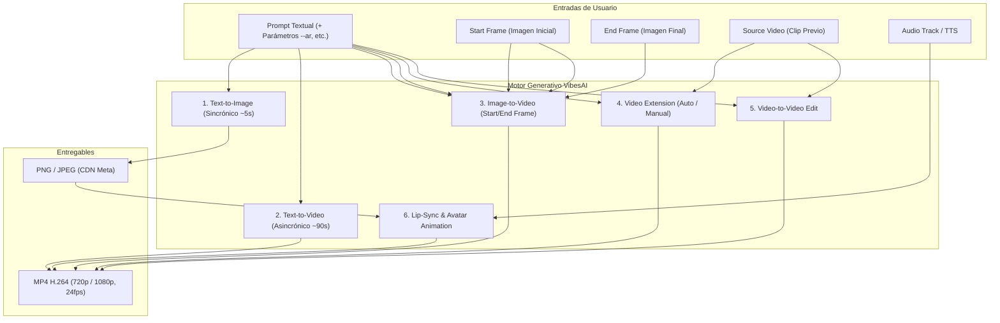

# Especificación Técnica: Generación de Imágenes y Videos (VibesAI-api)

> **Documento de Especificación Funcional y Técnica**  
> **Versión:** 1.6.0-custom  
> **Estado:** Aprobado / Implementado  
> **Alcance:** Motor de Generación de Medios Sintéticos (Imágenes y Videos) en el SDK Python (`vibes_api`), Interfaz CLI (`vibes-api`) y Servidor REST (`server/app.py`).

---

## 1. Resumen Ejecutivo y Arquitectura de Medios

La plataforma **VibesAI-api** proporciona una interfaz programática completa sobre el motor de difusión generativa de Meta (**Movie Gen / Vibes v2**). El subsistema de medios cubre dos grandes dominios:

1. **Generación y Edición de Imágenes (t2i / i2i):** Ejecución sincrónica de baja latencia (~3 a 8 segundos) orientada a la creación de arte conceptual, fotogramas clave (*keyframes*) y avatares.
2. **Generación, Animación y Edición de Video (t2v / i2v / v2v):** Ejecución asincrónica distribuida (~60 a 180 segundos por lote) orientada a la síntesis de secuencias cinematográficas de 5 segundos a 24 fps, con soporte de encadenamiento temporal (10s+).



---

## 2. Especificación: Generación de Imágenes

### 2.1 Text-to-Image (t2i) — `generate_image()`
Genera una imagen fija de alta resolución a partir de un prompt descriptivo.

* **Naturaleza del Endpoint:** Sincrónico. La llamada HTTP bloquea hasta que Meta devuelve la URL final del CDN y el ID de entidad.
* **Tiempo de respuesta:** ~3 a 8 segundos.
* **Firma SDK:**
  ```python
  client.generate_image(
      prompt: str,
      aspect_ratio: Union[str, AspectRatio] = AspectRatio.PORTRAIT,
      project_id: Optional[str] = None,
      user_action: Optional[str] = None
  ) -> dict
  ```
* **Formatos y Relaciones de Aspecto (`AspectRatio`):**
  * `PORTRAIT` / `9:16`: 576 × 1024 px (Ideal para Reels, TikTok, Shorts y Keyframes móviles).
  * `LANDSCAPE` / `16:9`: 1024 × 576 px (Formato panorámico/cinematográfico para cine y YouTube).
  * `SQUARE` / `1:1`: 1024 × 1024 px (Formato cuadrado para perfiles, avatares y feed).
* **Estructura de Retorno:**
  ```json
  {
    "mediaEntId": "893471029384756",
    "imageUrl": "https://scontent-iad3-2.xx.fbcdn.net/.../image.png",
    "prompt": "Character portrait...",
    "aspectRatio": "9:16"
  }
  ```

### 2.2 Edición y Variación de Imágenes — `edit_image()`
Reinterpreta o modifica una imagen generada previamente aplicando un nuevo prompt de transformación o conservando ciertas características.

* **Firma SDK:**
  ```python
  client.edit_image(
      source_image_ent_id: str,
      prompt: str,
      aspect_ratio: Optional[Union[str, AspectRatio]] = None
  ) -> dict
  ```

### 2.3 Carga de Medios Locales — `upload_media()` / `upload_image()`
Permite subir imágenes locales (PNG, JPG, WebP) a los servidores de Meta para integrarlas en el pipeline generativo.

* **Procesamiento previo:** Validación de tipos MIME y compresión automática recomendada si excede 5 MB para evitar errores `413 Request Entity Too Large`.
* **Retorno:** Devuelve el par `{imageEntId, imageUrl}` requerido para operaciones de video.

---

## 3. Especificación: Generación de Videos

### 3.1 Text-to-Video (t2v) — `generate_video()`
Genera una secuencia de video completa desde cero a partir de texto.

* **Naturaleza del Endpoint:** Asincrónico (Crea un `generation_batch` y se sondea con `wait_for_batch()` o streaming SSE).
* **Duración:** ~5.0 segundos estándar.
* **Cuadros por segundo (fps):** 24 fps (~120 fotogramas).
* **Tiempos de render:** ~60 a 180 segundos por lote.
* **Variaciones:** 1 a 4 videos simultáneos por batch (`variations=1..4`).
* **Calidades y Resoluciones (`Resolution`):**
  * `720p`: 1280×720 (16:9) o 720×1280 (9:16). Recomendada por velocidad y estabilidad.
  * `1080p`: 1920×1080 (16:9) o 1080×1920 (9:16). Mayor detalle y nitidez.
* **Modelos de Video (`VideoModel`):**
  * `v2` (Por defecto): Balance óptimo de realismo, física y coherencia de movimiento.
  * `fast`: Menor latencia de render.
  * `expressive`: Enfoque dinámico en micro-expresiones faciales y dramatismo.
* **Firma SDK:**
  ```python
  client.generate_video(
      prompt: str,
      project_id: Optional[str] = None,
      aspect_ratio: Union[str, AspectRatio] = AspectRatio.PORTRAIT,
      resolution: Union[str, Resolution] = Resolution.P720,
      variations: int = 1,
      video_model: Union[str, VideoModel] = VideoModel.V2,
      start_frame: Optional[dict] = None,
      end_frame: Optional[dict] = None,
      ingredients: Optional[List[dict]] = None
  ) -> dict
  ```

---

## 4. Modos Avanzados de Control de Video

### 4.1 Image-to-Video (Start Frame)
Ancla de manera obligatoria el **primer fotograma ($t=0\text{s}$)** del video a una imagen fija preexistente.

* **Propósito:** Consistencia del 100% en rostro, vestimenta, entorno y estética de arte.
* **Mecanismo:** El modelo no alucina al personaje; toma los píxeles de la imagen inicial y propaga el campo de movimiento temporal según el prompt de acción.
* **Estructura del parámetro `start_frame`:**
  ```python
  start_frame = {
      "imageEntId": "893471029384756",
      "imageUrl": "https://scontent-iad3-2.xx.fbcdn.net/.../image.png"
  }
  ```
* **Payload HTTP resultante (`/api/generate/video`):**
  ```json
  {
    "inputs": [
      {
        "type": "image",
        "imageUrl": "https://scontent-...",
        "imageEntId": "893471029384756"
      }
    ],
    "config": {
      "directPromptImageHandle": "893471029384756",
      "aspectRatio": "9:16"
    }
  }
  ```

### 4.2 End Frame e Interpolación Temporal
Define el **fotograma de llegada ($t=5\text{s}$)** del video.

* **Propósito:** Transiciones forzadas, metamorfosis de personajes o encuadres de precisión donde se conoce exactamente cómo debe terminar la escena.
* **Start + End Frame:** Si se proporcionan ambos, el motor interpola el movimiento desde el estado inicial hasta el estado final en el lapso de 5 segundos.

### 4.3 Extensión de Video (Video Extend)
Permite prolongar la duración de un clip más allá de los 5 segundos iniciales.

* **Auto Extend (`auto_extend_video`):**
  * Toma un clip existente y genera automáticamente los siguientes ~5 segundos ($5\text{s} \to 10\text{s}$), extrapolando el movimiento natural sin modificar la intención de la escena.
  ```python
  extended_batch = client.auto_extend_video(source_video=video_content_item)
  ```
* **Manual Extend (`manual_extend_video`):**
  * Prolonga el clip inyectando una directiva de cambio de acción a partir del último fotograma.
  ```python
  extended_batch = client.manual_extend_video(
      source_video=video_content_item,
      prompt="The character turns around quickly hearing footsteps"
  )
  ```

### 4.4 Edición Video-a-Video (v2v / `edit_video`)
Re-renderiza un video completo aplicando una transformación global preservando el flujo óptico y movimiento estructural original.

* **Requisitos:** Requiere los metadatos de generación del video previo (`videoHandle`, `videoGenEntId`, `structuredOutput`).
* **Casos de uso:** Cambiar el clima (de soleado a lluvia torrencial), transformar el estilo visual (de live-action a anime o acuarela), o alterar la indumentaria sin perder la actuación original.

### 4.5 Animación de Imágenes (Image Animate)
Transforma cualquier fotografía estática de la biblioteca en un video dinámico:

* **`auto_animate_image()`:** Reutiliza el prompt original con el que se concibió la imagen para ponerla en movimiento.
* **`manual_animate_image()`:** Aplica una instrucción cinemática explícita (e.g., *"slow subtle camera zoom, blinking eyes"*).

---

## 5. Matriz de Capacidades y Parámetros

| Funcionalidad | Entrada Principal | Salida | Tipo de Operación | Tiempo Estimado |
|---|---|---|---|---|
| **Text-to-Image** | Prompt (texto) | Imagen PNG/JPG | Sincrónica | 3 – 8 seg |
| **Image Edit** | Imagen + Prompt | Imagen PNG/JPG | Sincrónica | 3 – 8 seg |
| **Text-to-Video** | Prompt (texto) | Video MP4 (5s) | Asincrónica (Batch) | 60 – 120 seg |
| **Start Frame (i2v)** | Imagen + Prompt | Video MP4 (5s) | Asincrónica (Batch) | 60 – 120 seg |
| **Start + End Frame** | 2 Imágenes + Prompt | Video MP4 (5s) | Asincrónica (Batch) | 70 – 140 seg |
| **Auto Extend** | Video previo | Video MP4 (+5s) | Asincrónica (Batch) | 60 – 120 seg |
| **Manual Extend** | Video previo + Prompt | Video MP4 (+5s) | Asincrónica (Batch) | 60 – 120 seg |
| **Video Edit (v2v)** | Video previo + Directiva | Video MP4 (5s) | Asincrónica (Batch) | 80 – 150 seg |
| **Lip-Sync** | Cara/Avatar + Audio | Video MP4 sincronizado | Asincrónica (Job) | 45 – 90 seg |

---

## 6. Interfaces de Consumo

### 6.1 SDK de Python
```python
from vibes_api import VibesClient, AspectRatio, Resolution

client = VibesClient()

# 1. Generar Imagen Keyframe (Compuerta 1)
img = client.generate_image(
    prompt="Cinematic portrait of a speleologist in cavern",
    aspect_ratio=AspectRatio.PORTRAIT
)

# 2. Generar Video guiado por Imagen (Compuerta 2)
batch = client.generate_video(
    prompt="Slow camera pan past the character towards the dark cavern tunnel",
    aspect_ratio=AspectRatio.PORTRAIT,
    resolution=Resolution.P720,
    start_frame={"imageEntId": img["mediaEntId"], "imageUrl": img["imageUrl"]}
)

# 3. Esperar finalización y descargar
completed = client.wait_for_batch(batch["id"], timeout=300)
client.download_video(completed["content"][0]["id"], "escena_01.mp4")
```

### 6.2 Interfaz de Línea de Comandos (CLI)
```bash
# Generar imagen 9:16
vibes-api image --prompt "Romanian speleologist 1986" --aspect-ratio 9:16 --download ./keyframe.png

# Generar video Text-to-Video
vibes-api video --prompt "Slow camera dolly-in past speleologist" --aspect-ratio 9:16 --resolution 720p

# Ejecución One-Shot (Genera y descarga en un solo comando)
vibes-api one-shot --prompt "Serene sunrise over mountains" --aspect-ratio 16:9 --download-dir ./salida
```

### 6.3 Servidor REST (FastAPI)
* `POST /api/generate/image` → Generación inmediata de imagen.
* `POST /api/generate/video` → Encola batch de video y devuelve `batch_id`.
* `GET /api/generation-batches/{batch_id}` → Consulta de estado de lote.
* `GET /api/sync/stream` → Eventos en tiempo real mediante Server-Sent Events (SSE).

---

## 7. Manejo de Errores y Cuotas

1. **Rate Limiting (HTTP 429):**
   * El cliente incluye retroceso exponencial automático (`exponential backoff`) leyendo la cabecera `Retry-After`.
2. **Cuotas de Generación (GENERATION_FAILED):**
   * Si la cuenta de Meta agota sus créditos de generación, el estado del batch pasa a `GENERATION_FAILED` con detalle explicativo del límite de cuota.
3. **Control de Sesión (HTTP 401):**
   * Re-autenticación OIDC transparente en caso de tener configurado `AUTH_META_COOKIES`.
4. **Dimensiones estrictas de Aspect Ratio:**
   * Solo son válidas las proporciones `1:1`, `9:16` y `16:9`. Cualquier otro valor es rechazado a nivel de cliente para evitar consumo infructuoso de peticiones.
