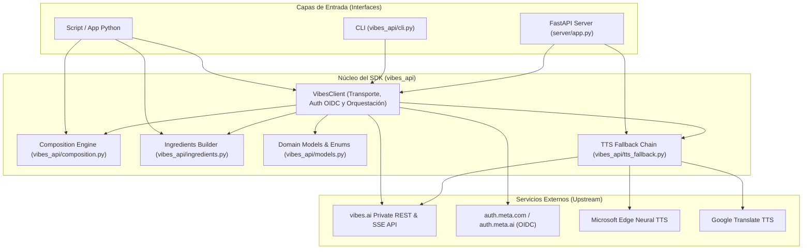
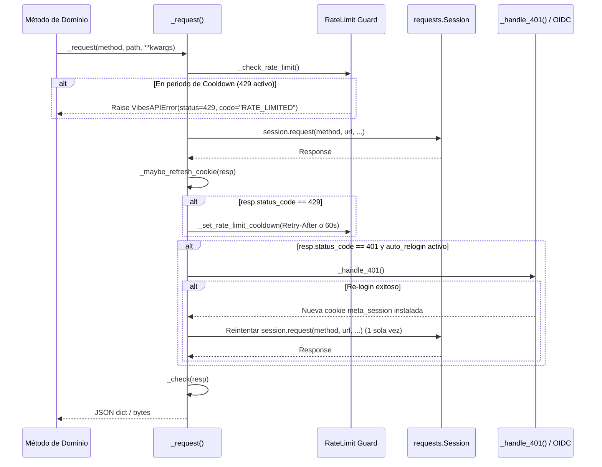

# Especificación de Arquitectura: VibesAI-api

> **Documento:** `02_ARCHITECTURE_SPEC.md`  
> **Estado:** Especificación Base y Arquitectura Objetivo  
> **Relacionado con:** `00_CONSTITUTION.md`, `01_SYSTEM_ANALYSIS.md`

---

## 1. Visión General de la Arquitectura

El sistema **VibesAI-api** sigue una arquitectura en capas donde el núcleo es el SDK de Python (`vibes_api`), sobre el cual se apoyan dos adaptadores de interfaz: la CLI (`vibes_api.cli`) y el servidor REST (`server.app`).



---

## 2. Arquitectura Actual vs. Arquitectura Modular Objetivo

### 2.1 Problema del Monolito Actual (`vibes_api/client.py`)
Actualmente, `vibes_api/client.py` concentra **4,487 líneas** y más de 130 métodos en una única clase `VibesClient`. Esto dificulta la lectura, propició la duplicación accidental de métodos (`start_background_refresh`, `_maybe_refresh_cookie`) y mezcla transporte HTTP de bajo nivel con validaciones estáticas y lógica de negocio.

### 2.2 Diseño Modular Objetivo (Mixins / Sub-módulos con Retrocompatibilidad 100%)
Para respetar el **Principio IV de la Constitución** (módulos ≤ 800 líneas) **sin romper ninguna importación existente** (`from vibes_api import VibesClient` y `from vibes_api.client import VibesClient`), `VibesClient` debe componerse internamente mediante Mixins especializados o módulos de dominio:

```
vibes_api/
├── __init__.py              # Superficie pública (retrocompatible 100%)
├── models.py                # Enums y constantes de dominio
├── exceptions.py            # VibesAPIError y subtipos (VibesAuthError, VibesRateLimitError)
├── utils.py                 # _uuid_v7, _mg_request_id, _base36_id, _coerce, _ms_now
├── validation.py            # Validadores offline y parse_midjourney_params
├── ingredients.py           # IngredientRef, CreateIngredient, build_ingredient_payload
├── composition.py           # Motor local Composition
├── tts_fallback.py          # Cadena de síntesis de voz (vibes -> edge-tts -> gtts)
├── _transport.py            # Base HTTP (_get, _post, _put, _patch, _delete), RateLimit, Auth & OIDC Relogin
├── _mixins/
│   ├── projects.py          # CRUD de proyectos, activos y revisiones
│   ├── generation.py        # Lotes, t2v, t2i, extend, edit_video, animate_image, regenerate, lipsync
│   ├── studio.py            # Ingredientes CRUD, moodboards, voces, TTS
│   ├── media.py             # Librería multimedia, uploads, descargas, música y audio
│   ├── timeline.py          # Timeline AI chat (SSE), export sync/async, sync SSE
│   └── social.py            # Share links, colaboradores, playables, publishing, analytics y settings
├── client.py                # Ensambla VibesClient heredando de _transport + _mixins (re-exporta helpers)
└── cli.py                   # Interfaz de línea de comandos
```

> [!IMPORTANT]
> **Contrato de Retrocompatibilidad:** `vibes_api/client.py` debe seguir exponiendo `VibesClient`, `VibesAPIError`, `_uuid_v7`, `_mg_request_id`, `_base36_id`, `_coerce` y `_ms_now`, además de contener las constantes de rutas o delegarlas limpiamente para que todos los tests de inspección existentes sigan pasando sin modificaciones traumáticas.

---

## 3. Especificación de la Capa de Transporte y Resiliencia (`_transport.py` / `VibesClient`)

### 3.1 Pipeline Unificado de Peticiones HTTP
Toda petición HTTP (`GET`, `POST`, `PUT`, `PATCH`, `DELETE`) debe atravesar un único método central `_request(method, path, ...)`:



### 3.2 Unificación del Hilo de Refresco en Segundo Plano (`background_refresh`)
Se debe eliminar la definición duplicada de `start_background_refresh()` y `stop_background_refresh()`, conservando una única implementación consolidada que:
1. Sea *thread-safe* y utilice `threading.Event` para parada limpia.
2. Ejecute `self._get("/api/auth/me")` (o `/api/auth/check-token`) cada `refresh_interval` segundos (por defecto `1500s` = 25 min).
3. Gracias al pipeline unificado `_request()`, si la llamada recibe `401`, dispare automáticamente `_handle_401()` (notificando a `on_session_expired` e intentando `_attempt_oidc_relogin()` si `auth_meta_cookies` está configurado).

---

## 4. Especificación de Arquitectura del Servidor REST (`server/app.py`)

### 4.1 Modelo de Concurrencia en FastAPI
Dado que `VibesClient` utiliza `requests.Session` (I/O síncrono bloqueante) y `time.sleep()` (durante el polling de lotes):
- **Regla 1:** Todos los endpoints de FastAPI que llamen a métodos síncronos de `VibesClient` deben declararse con `def` (función síncrona estándar) en lugar de `async def`, **o bien** ejecutar el método del cliente mediante `await asyncio.to_thread(client.metodo, ...)`.
- **Regla 2:** Los endpoints puramente asíncronos (como `POST /api/v1/tts` que usa `synthesize_speech_async`) se mantienen como `async def`.
- **Regla 3:** Los endpoints de streaming SSE (`POST /api/v1/timeline/chat/stream`, `GET /api/v1/batches/{bid}/stream`, `GET /api/v1/sync/stream`) deben ofrecer soporte mediante `StreamingResponse(media_type="text/event-stream")` además del modo agregado por lotes cuando el cliente lo solicite.

### 4.2 Estructura de Modelos y Rutas en `server/`
- Renombrar los modelos Pydantic de 2 letras a nombres semánticos claros (ej. `ProjectCreateRequest`, `ProjectUpdateRequest`, `VideoGenerateRequest`, `ImageGenerateRequest`, `TTSRequest`, `LipSyncRequest`, etc.), manteniendo los alias si algún consumidor interno los importaba.
- Sincronizar la versión de la aplicación FastAPI con `vibes_api.__version__` (`from vibes_api import __version__`).
- Reemplazar los bloques `except: pass` en `get_client()` por manejo explícito de `OSError` con `logging.warning(...)`.

